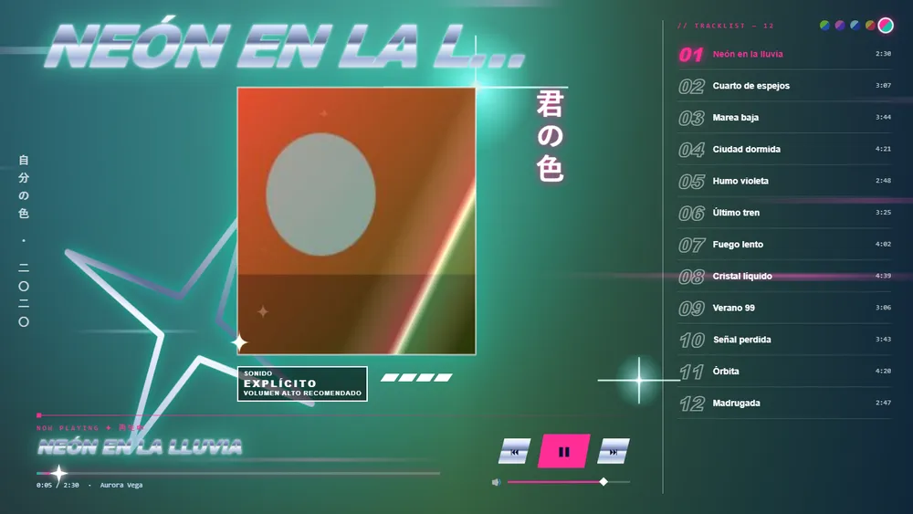
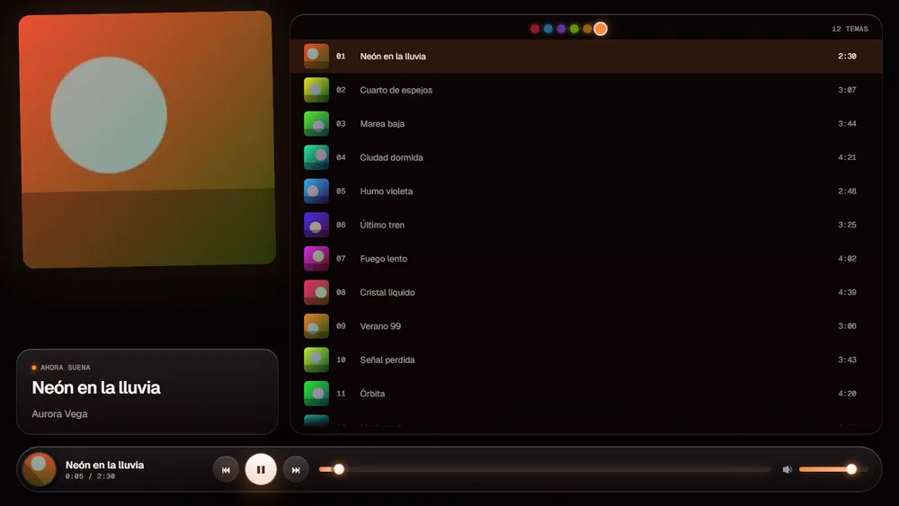
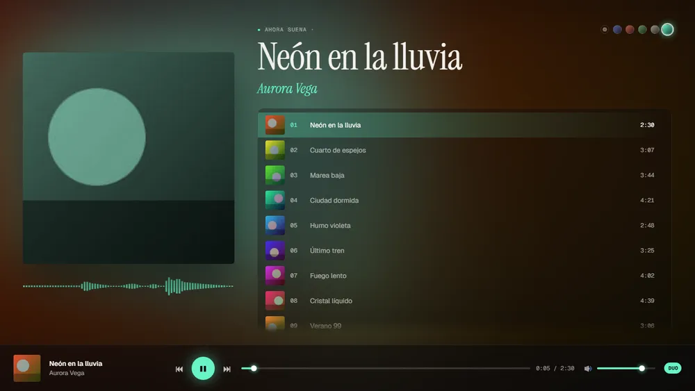

# Comunidad del reproductor visual

Plantillas que la gente comparte para [reproductor-visual](https://github.com/Noull999/reproductor-visual), la app que pone pantallas que reaccionan a tu música: colores, fondos, plantillas hechas en el Editor y ajustes de las incluidas.

**[Ver la galería web](https://reproductor-comunidad.vercel.app)**

## Para qué plantillas se comparte

La app trae 12 plantillas. Lo que se comparte aquí son tus **ajustes** de ellas (tu color, tu fondo, tu cuerpo propio…) o plantillas enteras que armaste en el **Editor**.

<table>
<tr>
<td align="center"><br><b>Líquido</b></td>
<td align="center"><br><b>Headspace</b></td>
<td align="center"><br><b>2000s</b></td>
</tr>
<tr>
<td align="center"><br><b>Ambiente</b></td>
<td align="center"><br><b>Pixel</b></td>
<td align="center"><br><b>Winamp</b></td>
</tr>
<tr>
<td align="center"><br><b>Psicodélico</b></td>
<td align="center"><br><b>Neo Y2K</b></td>
<td align="center"><br><b>Dreamcore</b></td>
</tr>
</table>

## Ya en la comunidad

Son ejemplos para que el catálogo no empiece vacío.

<table>
<tr>
<td align="center"><br><b>Neo Y2K magenta</b></td>
<td align="center"><br><b>Líquido atardecer</b></td>
<td align="center"><br><b>Ambiente menta</b></td>
</tr>
</table>

## Cómo usar una plantilla

1. En la app, abre la pestaña **Comunidad**.
2. Elige una plantilla y toca **Instalar**.

También puedes descargar el archivo desde la [galería web](https://reproductor-comunidad.vercel.app) e importarlo con **Importar plantilla…** en la Biblioteca.

La app solo descarga desde este repositorio, revisa el archivo entero antes de usarlo y nunca ejecuta nada: una plantilla son solo datos e imágenes. No lleva tus cuentas ni tus canciones.

## Cómo compartir la tuya

Mira [CONTRIBUIR.md](CONTRIBUIR.md). En corto: exportas desde la app, agregas tres archivos y abres un pull request. Un revisor automático comprueba que todo esté bien y yo lo apruebo. Tu **usuario de GitHub** queda como autor verificado, y si tu archivo trae imágenes debes decir de dónde vienen.

*(Una subida más simple, directo en la página y con tu cuenta de GitHub, está en camino.)*

## Cómo funciona

```
entradas/<nombre>.json          nombre, autor, descripción y, si hay imágenes, de dónde vienen
plantillas/<nombre>.plantilla   el archivo que exporta la app
previas/<nombre>.webp           una captura de cómo se ve
catalogo.json                   lo arma GitHub solo; no se edita a mano
sitio/                          la galería web (también se arma sola)
herramientas/                   el revisor de envíos y los constructores del catálogo y la galería
```

- `herramientas/validar.py` usa los mismos revisores que la app, así que lo que pasa aquí también se puede importar allá.
- Cuando se aprueba un envío, GitHub regenera `catalogo.json` (con el usuario de GitHub de quien lo envió, tomado del pull request) y `sitio/`, y Vercel publica la galería.
- Las pruebas (`python -m pytest`) necesitan la carpeta de la app al lado, en `../visualizador`, o la variable `APP_REPRODUCTOR`.

## Galería web

La carpeta `sitio/` es una página estática con todas las plantillas. Para publicarla gratis en Vercel o Cloudflare Pages: importa este repositorio, deja el comando de build vacío y pon `sitio` como carpeta de salida (el archivo `vercel.json` ya lo indica).

Las herramientas de este repositorio son [MIT](LICENSE). Cada plantilla es de su autor y la comparte para que otras personas la usen.
